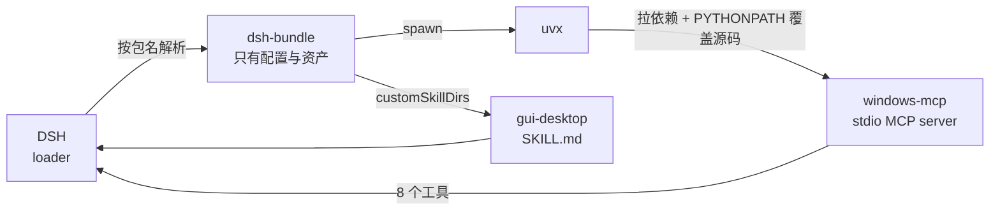

# GUI · DSH 的图形层

**简体中文**

[](https://github.com/forkgo430/dsh-gui-forkgo/actions/workflows/ci.yml)
[](LICENSE)
[](#提供什么)
[](#环境要求)

让 AI 操作 Windows 界面：截屏观察、点击、输入、快捷键、窗口与进程、虚拟桌面。

改文件、跑脚本这类事用 `pwsh` 更快。GUI 针对的是命令行碰不到的流程：安装向导、
登录弹窗、没有 CLI 的老软件、要拖拽才能完成的界面。

<sub>作者：**赢容** · 与 [WPS 多面手](https://github.com/forkgo430/wps-multitool-mcp) 同一作者</sub>

## 30 秒上手

三种装法，选一个：

```powershell
# ① 从 npm（最省事）
npm i dsh-gui-forkgo

# ② 本地目录（改源码立即生效，开发用这个）
# 插件页 → 添加插件 → 本地目录 → 选本仓的 dsh-bundle/
plugin_manager install_bundle，target 指到 dsh-bundle/ 的绝对路径

# ③ GitHub Release 的 tgz
npm i https://github.com/forkgo430/dsh-gui-forkgo/releases/download/v1.3.1/dsh-gui-forkgo-1.3.1.tgz
```

三个渠道的版本号都是 **1.3.1**，内容一致 —— npm 已经和本地对齐，装哪儿都一样。
从本地目录装最省事，也最容易改。

> **1.3.0 发不出去，别去试。** npm 服务端把版本 `1.3.0` 标成「已占用」：
> `409 Cannot publish over previously staged version "1.3.0"`，
> 但 `https://registry.npmjs.org/-/stage` 返回 `{"items":[],"total":0}` —— 暂存队列其实是空的。
> 服务端状态不一致，没有客户端能绕过去，只能换版本号。1.3.1 就是换号后的那一版。

装完重启插件行，可以直接说：

> 帮我看看屏幕上现在是什么

> 点一下那个"下一步"

> 把记事本里那段文字复制出来

其他例子：

- "等安装向导出现，一路点下一步"
- "在浏览器的地址栏输入 xxx 然后回车"
- "把这两个窗口分到两个虚拟桌面上"

## 提供什么

服务器名是 `gui`，工具名形如 `mcp__gui__<工具名>`，共 **8 个**：

| 工具 | 干什么 | mode / action |
|---|---|---|
| `Screen` | 看屏幕 | `full`（控件树 + 图，默认）· `fast`（只出图）· `displays`（显示器与 DPI） |
| `Input` | 鼠标、键盘、剪贴板、等待 | `click` `type` `scroll` `move` `shortcut` `wait` `wait_for` `multi_select` `multi_edit` `clipboard_get` `clipboard_set` `sequence` |
| `Programs` | 启动程序、管窗口、查杀进程 | `launch` `launch_executable` `resize` `switch` `list` `kill` |
| `System` | 命令、文件、注册表 | 文件 `read` `write` `copy` `move` `delete` `list` `search` `info`；注册表 `reg_get` `reg_set` `reg_delete` `reg_list`；命令 `shell` |
| `Scrape` | 抓网页；`use_dom=true` 读浏览器当前页 | — |
| `ControlStatus` | 谁在控制、空闲多久交还、截图缓存状态 | `release` |
| **`VirtualDesktop`** | 任务栏那几组窗口：列出、新建、切换、重命名、删除、搬窗口 | `list` `current` `windows` `create` `switch` `rename` `remove` `move_window` |
| **`IsolatedSession`** | 独立子会话：AI 在另一个桌面里操作，不抢你的鼠标键盘 | `status` `setup` `start` `stop` `inject` `guard` `forget` |

另有一份技能 `gui-desktop`，说明这些工具的使用顺序。

### 为什么是 8 个

原来是 15 个，合并的依据是**参数包含关系**，不是为了数字好看：

```
Snapshot + Screenshot + DisplayInventory  →  Screen
App + Process                             →  Programs
PowerShell + FileSystem + Registry        →  System
Clipboard                                 →  Input 的 clipboard_get / clipboard_set
```

- `Screenshot` 的六个参数全在 `Snapshot` 里，`DisplayInventory` 一个参数都没有；
- `Clipboard` 的 `text` 在 `Input` 里本来就是参数，`Input` 内部的 `_paste_text` 也一直在操作剪贴板；
- `App` / `Process` 都有 `name`，`System` 三个工具的安全注解完全一致（都会写盘）。

再往前一步：输入类工具原本是七个（`Click`、`Type`、`Scroll`、`Move`、`Shortcut`、
`Wait`、`WaitFor`），加上 `MultiSelect`、`MultiEdit` 一共九个，1.2.0 已经合并成
`Input` 一个入口。

**没合并的三个留着是有原因的**：`Scrape` 要调 LLM 做摘要；`VirtualDesktop` 和
`IsolatedSession` 一个动窗口分组、一个起独立会话，机制完全不同，硬塞进同一个
`action` 命名空间只会让参数语义变模糊。

合并唯一的成本是**同名参数语义不同**：`System` 的 `path` 在文件模式是文件路径、
在注册表模式是注册表键路径。所以每个 mode 都校验参数，传了不属于该 mode 的参数
直接报错并列出可用项，绝不静默忽略。

### 几处实现上的取舍

**`Screen` 默认是 `full`。** 调用方多半是「我要看着屏幕决定下一步」，取到坐标才有用。
要速度的人显式写 `mode="fast"`。

**`Screen` 默认不附图。** 只返回控件树，含角色、名称、坐标、可用动作、快捷键。
坐标可以直接用来点击。canvas、WebGL 和图片里的文字不在控件树里，这些情况才需要开 `use_vision`。

**`VirtualDesktop` 是本仓加的。** 上游 `windows-mcp` 写好了虚拟桌面的 COM 封装，
只用来过滤窗口列表，21 个工具里没有一个暴露它。这里挂成工具，并改掉上游封装
三处会让工具报假成功的地方。

**屏幕提示是中文的。** 接管桌面时四周有蓝光、顶部中间一块提示，接管前还有确认框：

```
┌─────────────────────────────────────┐
│        AI 正在控制这台电脑          │
│          大幅移动鼠标               │
│  或按 Ctrl+Alt+Shift+Backspace 接管 │
└─────────────────────────────────────┘
```

接管方式有两种：大幅移动鼠标，或按 `Ctrl + Alt + Shift + Backspace`。
面板在 1920 宽的屏上约 429×125，占屏幕 22%×12%；窄屏自动缩小。

字体用的是思源黑体 Noto Sans SC（标题 `Noto Sans SC Medium` 30px / 提示行 19px），
回退链是 思源 → 等线 → 雅黑 → 黑体。在本机 412 个字体里挑了几套渲染同一段中文做对比：
等线 Bold 横粗竖细、28px 下笔画发硬，雅黑 Bold 太粗、19px 提示行发糊，思源最干净。
面板不透明度从 0.88 提到 **1.0**——半透明会让背后任何文字透上来，和面板自己的标题
叠成两层，读起来像渲染重影。1.0 之后边缘仍有 8px 羽化，不会切出生硬的直角。

接管确认框也是同一套设计语言：Canvas 手绘、无边框、深蓝渐变底、亮蓝 2px 描边、
圆角、自绘按钮（悬停变色）、右上角自绘关闭键，Esc 等于拒绝。

**`IsolatedSession` 也是本仓加的（1.2.0）。**

它解决的是「AI 抢鼠标键盘」这个具体问题。做法是在同一台机器上开一个**子会话**
（Windows 的 Child Session），AI 在那个桌面里操作，你的桌面完全不受影响。

要一次 Windows 密码：首次 `setup` 会弹系统标准凭据框，密码用当前账户的 DPAPI
加密后存进凭据管理器 `dsh-gui/Session`，之后不再问。存的是**标准 DPAPI blob**，
不是自定义方案。

### 预览窗：看得见 AI 在干什么

`start` 会在主屏右下角摆一个**预览窗**，里面是子会话的实时画面——独立的桌面、
独立的图标、独立的任务栏。AI 在里面操作什么，你一眼就看得到。

```
┌─ DSH 子会话 — AI 正在这里面操作 ────────────┐
│                                              │
│        （子会话的实时桌面画面）              │
│                                              │
└──────────────────────────────────────────────┘
```

- **置顶**，可以拖动，标题栏上有关闭按钮
- 点它会把焦点给宿主窗口，但 AI 的动作发生在另一个会话里，碰不到你的键鼠
- 关掉预览窗＝断开连接，子会话跟着销毁（不是只关窗留个孤儿）
- 想挪到副屏：`start(left=1920, top=0)`
- 想回到完全不可见的老行为：`start(visible=false)`

**为什么需要它**：`Screen` 截的永远是你自己的桌面（MCP 进程跑在 Session 1），
子会话的画面只存在于那个 RDP 控件内部。窗口挪到屏幕外，AI 在里面干什么你完全
看不见——这正是上一版的样子。

`status` 里的 `preview_window` 会如实报告窗口在哪：

```json
"preview_window": {
  "visible": true, "minimized": false, "offscreen": false,
  "rect": {"left": 745, "top": 301, "width": 1145, "height": 749},
  "on_screen": true
}
```

`on_screen` 是三个 bool 的结论。窗口被拖到屏幕外、被最小化、或者用了
`visible=false`，这里都会是 `false`，不用自己去推。

### 会话内守护（guard）

子会话里跑着一个守护进程，负责关掉 `#32770` 对话框——UAC、报错框、安装确认框
这些会卡住自动化的东西。

**为什么必须它来做**：父会话看不见也碰不到子会话的窗口。Windows 按 session
隔离窗口站，实测父会话枚举到的子会话顶层窗口数是 0（自己的能看到 300 多个）。
所以在父进程里"找到弹窗再关掉"这条路根本不成立。

**怎么投进去的**：建会话之前把守护脚本挂到 HKCU 的 Run 键，子会话登录时系统会在
子会话里执行它。HKCU 是各会话共享的同一份注册表。豆包往 explorer 注入
`pip_remote.dll` 达到同样目的，那需要编译器，这台机器没有。

`start` 默认自动挂载，`stop` 自动撤下。看状态：

```json
"guard": {
  "running": true, "session": 6, "console_session": 1,
  "closed_total": 1, "beat_age_seconds": 0.3, "close_dialogs": true
}
```

`running` 是心跳判定的，不是"文件存在"——心跳超过 8 秒没刷新就算停了。

单独控制：`IsolatedSession(action="guard", enable=false)` 撤下，
`enable=true, close_dialogs=false` 只挂载不关窗，
`keep_titles="PowerToys;记事本"` 保留这些标题不关。

三点已知约束，先说在前面：

- **子会话的存活绑在 RDP 宿主进程上**，宿主一退会话就掉线。`start` 会起一个
  独立的宿主进程，插件重载不影响它。
- 一个系统同一时刻只能有一个活动子会话。
- **能用 UIA 控件模式做的事本来就不动真实指针**，那些场景不需要子会话。
  子会话只解决 canvas、自绘界面这类 UIA 覆盖不到的情况。

用法四步：

```
IsolatedSession(action="setup")   → 弹一次凭据框，存下来
IsolatedSession(action="start")   → 起宿主建会话，约 16 秒就绪，预览窗出现
IsolatedSession(action="status")  → 确认 state=active、explorer 在、预览窗 on_screen
IsolatedSession(action="stop")    → 收工，宿主退出 + 会话注销
```

调查与实测的完整记录（含微软文档没写的那条例外、注入链路验证、账户锁定的教训）
在 [`docs/虚拟桌面计划.md`](docs/虚拟桌面计划.md)。

## 环境要求

| 要求 | 说明 |
|------|------|
| Windows 10 / 11 | UI Automation 与虚拟桌面 API 只在 Windows 可用。**实际只在 Win10 19045 真机跑过，Win11 未验证** |
| DSH | 需要插件系统与 MCP 客户端（`@deepseek-ai/dsh-mcp-client`） |
| [`uvx`](https://docs.astral.sh/uv/) 在 PATH 上 | 首次启动会拉 Python 3.14 与 pywin32、comtypes、dxcam。**没装 uvx 是 Win11 上最常见的报错来源**——`mcp-client(gui): initial connection or tool synchronization failed`，装好 `winget install --id=astral-sh.uv -e` 再重启插件行 |
| 中文字体（可选） | 屏幕提示优先用 Noto Sans SC 思源黑体，没装会自动回退到等线 → 雅黑 → 黑体，不影响功能 |

## 它怎么工作



bundle 里没有可执行代码，只有配置和资产。实际执行的是 `uvx` 拉起的 `windows-mcp` 子进程。

## 边界

**虚拟桌面不隔离输入。** 切换之后鼠标键盘仍然共享，被切走的桌面里进程照常运行、
照常出声。要真正隔离得用 `IsolatedSession` 那套子会话。

**Windows 10 19045 上实测到三条限制**，工具会直接拒绝，不返回假成功：

| 限制 | 表现 | 原因 |
|---|---|---|
| 不支持桌面命名 | `rename` / `create(name=)` 抛 `NotImplementedError` | 命名是 Win11 22000+ 的能力，19045 的 vtable 里没有 `SetName` |
| 新建不自动切换 | `create` 返回 `switched:false` | Win11 会切，Win10 不切 |
| `move_window` 只搬本进程窗口 | 别的进程的窗口抛 `PermissionError` | 见下 |

第三条试过三条替代路线，在这个版本上都不可用：
`IApplicationViewCollection.GetViewForHwnd` 加 `MoveViewToDesktop`（`QueryService` 返回 `E_NOTIMPL`）、
`Shift+Win+←/→` 系统加速键（忽略合成输入）、各种指针封送写法（都是同一个 `E_ACCESSDENIED`）。
和权限无关：同一 token、同一会话下，自己的窗口能搬，别人的不能。

## 结构

```
dsh-gui-forkgo/
├── dsh-bundle/              ← 装进 DSH 的就是这个目录
│   ├── package.json
│   ├── cordis.patch.yml     挂 MCP 客户端 + 技能扫描根
│   ├── skills/
│   │   └── gui-desktop/SKILL.md
│   ├── vendor/windows-mcp/  windows-mcp 0.8.9 源码树（本分支改动在这里）
│   ├── locale/{zh,en}.json
│   ├── docs/DETAIL.md
│   └── selftest.js          结构 + 技能 + 连接层自检
├── docs/虚拟桌面计划.md      子会话的调查与实测记录
├── .github/workflows/ci.yml
├── package.json
├── CHANGELOG.md
├── README.md
└── LICENSE
```

## 自检

改完先跑一遍，不需要 dsh：

```powershell
npm run selftest           # 结构 + 技能 + 连接层
npm run selftest:offline   # 只验结构与技能
```

连接层会真起一次 MCP。依赖已经在缓存里时约 5 秒，首次要拉 Python 3.14 和依赖，
实测 11 秒左右。

### 改完源码怎么生效

> ## ⚠ 改完源码必须删 `__pycache__`
>
> 用本地目录装法时，改代码不会自动生效，顺序是：
>
> ```
> 改源码
>   → 关掉插件行 include:gui
>   → 删掉 vendor/windows-mcp 下的所有 __pycache__
>   → 重新打开插件行
> ```
>
> **不删就跑，等于没改。** Python 会优先用 `.pyc` 里的旧字节码，进程重启后跑的还是
> 旧逻辑，而且**没有任何征兆**——不报错、不告警、日志干净。我在这上面浪费过一整轮
> 排查：代码确认改了、进程确认重启了、行为还是旧的。这一步**没有例外**。

一条命令清掉：

```powershell
Get-ChildItem dsh-bundle\vendor\windows-mcp -Recurse -Directory -Filter __pycache__ |
  Remove-Item -Recurse -Force
```

`vendor/` 之外的地方改了不用管，只有这份源码树走 `PYTHONPATH`。

下面是自检覆盖的四类「改对了也看不出来」的问题：

1. **包结构** —— `dsh.bundle.patch` 是否存在、`args` 里有没有相对路径、
   `command` 是不是探测而来（不能写死某个人的 uvx 路径）、`--from` 有没有钉版本、
   `PYTHONPATH` 是不是由 `!!js` 反解而不是写死的绝对路径、`vendor/` 是不是完整的源码树。
2. **技能 frontmatter** —— `name` 是否为 kebab-case 且与目录名一致、`description` 是否为空。
   缺 description 时 dsh 不会加载，也不报错，表现是「AI 不会用」。
3. **连接层** —— 真起 stdio、列工具，确认工具数是 8、8 个名字都在、9 个旧工具名
   一个都没重现、每个工具的 `mode` 枚举齐全、名字不重复、屏幕文案是中文。
4. **控制权分类** —— `control_policy.py` 是否覆盖了全部 8 个工具。
   这条漏了不会报错，只会让只读的 `Screen` 也去抢用户的鼠标键盘。

## 与上游的关系

包本体是 [`windows-mcp`](https://pypi.org/project/windows-mcp/) 0.8.9 的副本加改动，
放在 `dsh-bundle/vendor/windows-mcp/`，用 `PYTHONPATH` 覆盖；依赖仍由 `uvx` 从 PyPI 安装。
上游是 MIT，版权声明随附在 `vendor/windows-mcp/LICENSE-upstream.md`。

不用 `uvx --from <本地目录>` 的原因：uvx 对本地目录的构建缓存不看文件 mtime，
改完源码它照样复用上一次构建的产物。实测把整份文案改成中文之后跑起来还是英文，
也没有任何提示。`PYTHONPATH` 能让源码直接生效。

代价是那个目录必须放完整源码树，不能只放改动的文件。`PYTHONPATH` 一旦命中，
同名子模块全部从那里取，缺文件就是 ImportError。

## 隐私

- 屏幕内容不出本机：没有遥测、没有崩溃上报、没有使用统计
- 唯一的出站行为是 `uvx` 首次启动时从 PyPI 拉依赖
- 截图落在 DSH 会话目录下（`.dsh-pilot/` 或你指定的 `save_path`）。敏感窗口不要截
- `IsolatedSession` 存的密码留在本机凭据管理器里，用当前账户的 DPAPI 加密，
  不经过网络，也不写进任何配置文件

## 已知限制

- 只支持 Windows：UI Automation 和虚拟桌面 API 都是 Windows 专有
- 默认会占用真实的鼠标键盘，人在键盘前动一下就会互相干扰。用 `IsolatedSession`
  开子会话可以避免，代价是一次 Windows 密码
- `System` 的 `shell` 模式是整机 shell，不受 DSH 文件沙箱限制。删文件、改注册表之前要先说一声
- canvas、WebGL、游戏画面这类只有像素没有控件树的界面必须走 `Screen` 的 `use_vision`，
  成本更高，而且要靠看图判断
- 合并成一个工具后，`System` 有 18 个参数。模型每次调用都要在整张表里挑出对应的三个，
  跨 mode 选错会多花一次往返。这是合并换来的紧凑度所付的代价

## 故障排除

| 问题 | 解决方案 |
|------|---------|
| **`mcp-client(gui): initial connection or tool synchronization failed`** | **先看下面那行 `cause`。十有八九是没装 `uvx`，或者装了但 PATH 里没有。`winget install --id=astral-sh.uv -e`，装完重开终端，再关掉插件行重新启用一次** |
| **npm 报 `409 Cannot publish over previously staged version`，但 `npm stage list` 是空的** | **这是 npm 服务端的版本状态不一致，不是本地的问题。`https://registry.npmjs.org/-/stage` 返回 `{"items":[],"total":0}`，暂存队列其实是空的，那个版本号却被钉成「已占用」——没有任何客户端参数能绕过去。**换版本号**（1.3.0 就是这么废掉的，直接用 1.3.1）** |
| 工具列表里没有 `mcp__gui__*` | 确认 `include:gui` 是 active；看插件页有没有启动失败 |
| 插件显示 failed 但手动能起 | DSH 缓存了失败的连接状态，把插件关掉再打开一次 |
| **改了源码但行为没变** | **删掉 `vendor/windows-mcp` 下的 `__pycache__` 再重启**。`.pyc` 旧字节码会盖住新代码，且毫无征兆 |
| **`Input` 报 `CONTROL_PREEMPTED` 且 `executed_steps: 0`** | **1.3.1 已修**（`checkpoint` 里那句 `or not self._suppress` 让第一步就被自己拒掉，租约拿到了却动不了手）。如果**升级到 1.3.1 之后还出现**，看 `ControlStatus` 里的 `arm_failures` / `arm_last_error`：良性竞态（`stale` / `not_ai` / `paused` / `stopping`）不计入，涨了就说明叠加层真的没挂上，`arm_last_error` 会写原因 |
| 工具用完光还亮着 | 1.3.1 起一轮工具调用结束后 **2 秒自动撤**（`glow_release_grace_seconds`，默认 2.0）。想调长就用环境变量 `WINDOWS_MCP_GLOW_GRACE_SECONDS`（秒，非负有限数，传错会打印告警并沿用默认）。`agent_idle_release_seconds`（120 秒）仍然作为长时间没动作的兜底 |
| 用 `Screen` 截不到蓝光 | **设计如此，不是 bug。** `Screen` 截图前会主动把叠加层藏起来再拍，否则每次截图都带着一圈蓝框和一块面板，既挡内容又污染帧去重。要确认光还在不在，用肉眼或 `ControlStatus` 的 `state` |
| 帧去重不生效，永远 `unchanged=false` | 去重**只在静止区域生效**。全屏连拍永远是 `false`——桌面总有像素在变（实测 0.098% 持续变化），这是正确行为。把 `region` 锁准一点才会拿到 `true`；另外去重状态是**进程级全局**的，不区分调用方，收到 `unchanged=true` 但手上没那张图时，带 `force_image=true` 再拍一次 |
| `VirtualDesktop` 不存在 | `vendor/windows-mcp` 没被带上，跑的是 PyPI 上游的 21 工具版 |
| 工具数变成 15 或更多 | `tools/__init__.py` 里旧模块又被加回去了。`selftest.js` 会直接报「旧工具 X 又出现了」 |
| 屏幕提示还是英文 | 同上，`PYTHONPATH` 没指到 `vendor/` 里的源码 |
| 技能不出现 | 跑 `npm run selftest`；缺 description 会跳过且不报错 |
| 首次调用很慢 | `uvx` 冷启动要拉 Python 3.14 与依赖，约 5 秒；之后走缓存 |
| `initialize` 超时 | 先手动跑一次 `uvx --python 3.14 --from windows-mcp==0.8.9 windows-mcp --help` 预热 |
| `IsolatedSession` 报 1909 | 账户被锁了。本机策略是 10 次失败锁 600 秒，等一会儿或换管理员账户解锁 |
| `start` 一直不到就绪 | `status` 看 `credential_saved` 是不是 true；看 `%TEMP%\dsh-gui-host-ready.txt` 有没有生成 |
| 子会话里 UAC / 报错框把自动化卡死 | `status` 看 `guard.running`（心跳，超 8 秒没刷新算停）和 `guard.closed_total`。`start` 默认已挂载；没挂上就 `IsolatedSession(action="guard", enable=true)`。父会话关不掉子会话的窗（窗口站按 session 隔离），只有守护进程在会话里面能碰 |
| `start` 说成功但屏幕上找不到预览窗 | `status` 看 `session_detail.preview_window.on_screen`。`false` 说明窗口被挪到屏幕外（`visible=false`）、被最小化、或者被拖走了。`stop` 后用 `start()` 重来；想固定位置传 `left`/`top` |
| 找不到子会话在干什么 | `Screen` 截的是你自己的桌面，永远不会包含子会话。要看子会话只能看那个预览窗 |
| `stop` 说关了但会话还在 | 1.2.2 之前的版本只关宿主不注销会话。升级到 1.2.2+，或用 `WTSLogoffSession` 手动清 |
| `VirtualDesktop` 传错桌面 | 1.2.2 起 `index` 统一从 1 开始。之前 `list` 返回 0 起、`target` 按 1 起解析，会差一位 |

## 许可

MIT。见 [LICENSE](LICENSE)。
