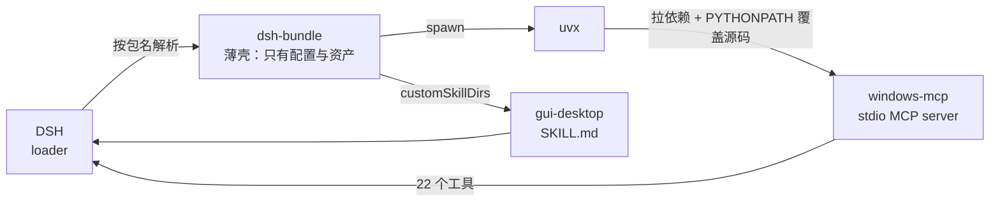

# GUI · DSH 的图形层

**简体中文**

[](https://github.com/forkgo430/dsh-gui-forkgo/actions/workflows/ci.yml)
[](LICENSE)
[](#提供什么)
[](#环境要求)

> 给 AI 装上眼睛和手：截屏观察、点击、输入、快捷键、窗口与进程、虚拟桌面。
>
> `pwsh` 能做的事它不快，但**只有图形界面才有的流程**——安装向导、登录弹窗、
> 没有 CLI 的老软件、要拖拽的界面——命令行碰不到。

| | 看 | 点 | 输入 | 快捷键 | 窗口 | 虚拟桌面 |
|---|:--:|:--:|:--:|:--:|:--:|:--:|
| Windows 10 / 11 | ✓ | ✓ | ✓ | ✓ | ✓ | ✓ |

<sub>作者 / 维护者：**赢容** · 与 [WPS 多面手](https://github.com/forkgo430/wps-multitool-mcp) 同一位作者</sub>

## 30 秒上手

先把 `dsh-bundle/` 装进 DSH：

```powershell
# 插件页 → 添加插件 → 本地目录 → 选本仓的 dsh-bundle/
# 或
plugin_manager install_bundle，target 指到 dsh-bundle/ 的绝对路径
```

重启插件行，然后直接说：

> 帮我看看屏幕上现在是什么

> 点一下那个"下一步"

> 把记事本里那段文字复制出来

更多例子：

- "等安装向导出现，一路点下一步"
- "在浏览器的地址栏输入 xxx 然后回车"
- "把这两个窗口分到两个虚拟桌面上"

## 提供什么

服务器名固定为 `gui`，工具名形如 `mcp__gui__<工具名>`，共 **22 个**：

| 能力 | 工具 | 说明 |
|---|---|---|
| 观察 | `Snapshot` · `Screenshot` · `DisplayInventory` | 控件树带可点坐标；`use_vision=False` 时纯文本**不附图** |
| 鼠标 | `Click` · `Move` · `Scroll` · `MultiSelect` | 按坐标或按控件；拖拽、滚轮、多选 |
| 键盘 | `Type` · `Shortcut` · `MultiEdit` | 输入、快捷键、批量填多格 |
| 窗口与程序 | `App` · `Process` · `Wait` · `WaitFor` | 启动、切换、调整窗口、等条件成立 |
| 文件与系统 | `FileSystem` · `Registry` · `PowerShell` · `Clipboard` · `Scrape` · `Notification` | |
| 控制权 | `ControlStatus` | 谁在控制、空闲多久交还 |
| **虚拟桌面** | **`VirtualDesktop`** | 任务栏那几组窗口：列出、新建、切换、重命名、删除、搬窗口 |

外加一份技能 **`gui-desktop`**，教模型按什么顺序用这 22 个工具。

### 三个值得说的设计

**`Snapshot` 默认不附图。** 只返回控件树（角色、名称、坐标、可用动作、快捷键），
比截图便宜得多，而且坐标直接可点。只有 canvas、WebGL、图片里的文字才需要开 `use_vision`。

**`VirtualDesktop` 是本仓新增的。** 上游 `windows-mcp` 把虚拟桌面的 COM 封装写好了，
却只用来过滤窗口列表，21 个工具里没有一个暴露它。这里挂成工具，并修掉上游封装
三处会让工具说谎的毛病。

**屏幕提示是中文的。** 接管桌面时四周有蓝光、顶部中间一块提示、接管前一个确认框：

```
┌─────────────────────────────────────┐
│        AI 正在控制这台电脑           │
│          大幅移动鼠标                │
│   或按 Ctrl+Alt+Shift+Backspace 接管 │
└─────────────────────────────────────┘
```

两种接管方式：大幅移动鼠标，或按 `Ctrl + Alt + Shift + Backspace`。
面板在 1920 屏上约 398×114（占屏 21%×11%），窄屏自动缩到 276×97。

## 环境要求

| 要求 | 说明 |
|------|------|
| Windows 10 / 11 | UI Automation 与虚拟桌面 API 只在 Windows 可用 |
| DSH | 有插件系统与 MCP 客户端（`@deepseek-ai/dsh-mcp-client`） |
| [`uvx`](https://docs.astral.sh/uv/) 在 PATH 上 | 首次启动自动拉 Python 3.14 与 pywin32、comtypes、dxcam |

## 它怎么工作



**bundle 是薄壳**：只有配置与资产，不含可执行代码。真正干活的是 `uvx` 拉起的
`windows-mcp` 子进程。

## 边界

**这不是输入隔离。** 切换虚拟桌面只隔离窗口，不隔离输入——鼠标键盘还是共享的，
被切走的桌面里进程照跑、照出声。要真正隔离得用 Terminal Server 子会话，
那是另一个量级的东西。

**Windows 10 19045 实测的三条硬限制**（工具里如实拒绝，不假装成功）：

| 限制 | 表现 | 原因 |
|---|---|---|
| 不支持桌面命名 | `rename` / `create(name=)` 抛 `NotImplementedError` | 命名是 Win11 22000+ 能力，19045 的 vtable 里没有 `SetName` |
| 新建不自动切换 | `create` 返回 `switched:false` | Win11 会切，Win10 不切 |
| `move_window` 只搬本进程窗口 | 别的进程的窗口抛 `PermissionError` | 见下 |

第三条排查过三条替代路线，本版本都不可用：
`IApplicationViewCollection.GetViewForHwnd` + `MoveViewToDesktop`（`QueryService` 返回 `E_NOTIMPL`）、
`Shift+Win+←/→` 系统加速键（忽略合成输入）、各种指针封送写法（同一个 `E_ACCESSDENIED`）。
**不是权限问题**——同一 token、同一会话，自己的窗口能搬。

## 结构

```
dsh-gui-forkgo/
├── dsh-bundle/              ← 装进 DSH 的就是这个目录
│   ├── package.json
│   ├── cordis.patch.yml     挂 MCP 客户端 + 技能扫描根
│   ├── skills/
│   │   └── gui-desktop/SKILL.md
│   ├── locale/{zh,en}.json
│   ├── docs/DETAIL.md
│   └── selftest.js          结构 + 技能 + 连接层自检
├── .github/workflows/ci.yml
├── package.json
├── CHANGELOG.md
├── README.md
└── LICENSE
```

## 自检

改完先跑一遍，不需要 dsh：

```powershell
npm run selftest           # 结构 + 技能 + 连接层（真起一次 MCP，约 5 秒）
npm run selftest:offline   # 只验结构与技能
```

它卡三件「改对了也看不出来」的事：

1. **包结构** —— `dsh.bundle.patch`、`args` 里没有相对路径、`PYTHONPATH` 指向完整源码树。
2. **技能 frontmatter** —— `name` 是 kebab-case 且与目录名一致、`description` 不为空。
   缺 description 时 dsh 会静默不加载，用户只看到「AI 不会用」，没有任何报错。
3. **连接层** —— 真起 stdio、列工具、确认 22 个里 `VirtualDesktop` 在、屏幕文案是中文。

## 与上游的关系

包本体基于 [`windows-mcp`](https://pypi.org/project/windows-mcp/) 0.8.9 的本地分支，
通过 `PYTHONPATH` 覆盖，依赖仍由 `uvx` 从 PyPI 装。

为什么不用 `uvx --from <本地目录>`：uvx 对本地目录的构建缓存**不跟文件 mtime 走**，
改完源码它照样复用上一次构建的产物。实测把整份文案改成中文之后跑起来还是英文，
而且没有任何提示。`PYTHONPATH` 让源码直接生效。

代价是那个目录必须是**全量源码树**，不能是增量覆盖层——`PYTHONPATH` 一旦命中，
同名子模块全部从那里取，缺文件就是 ImportError。

## 隐私

- **屏幕内容不出本机**：没有遥测、没有崩溃上报、没有使用统计
- 唯一的出站行为是 `uvx` 首次启动时从 PyPI 拉依赖
- 截图落在 DSH 会话目录下（`.dsh-pilot/` 或你指定的 `save_path`），敏感窗口请勿截屏

## 已知限制

- **仅 Windows**：UI Automation 与虚拟桌面 API 都是 Windows 专有
- **抢真实鼠标键盘**：这不是输入隔离，人在键盘前动一下就会打架
- **`PowerShell` 是整机 shell**：不受 DSH 文件沙箱限制，删文件改注册表前要说一声
- **部分 GUI 只有像素没有控件树**：canvas、WebGL、游戏画面必须走 `use_vision`，贵且靠猜

## 故障排除

| 问题 | 解决方案 |
|------|---------|
| 工具列表里没有 `mcp__gui__*` | 确认 `include:gui` 是 active；看插件页有没有启动失败 |
| `VirtualDesktop` 不存在 | `PYTHONPATH` 没生效，跑的是 PyPI 上游 21 工具版 |
| 屏幕提示还是英文 | 同上，`PYTHONPATH` 没指到本地源码树 |
| 技能不出现 | 跑 `npm run selftest`；缺 description 会静默跳过 |
| 首次调用很慢 | `uvx` 冷启动要拉 Python 3.14 与依赖，约 5 秒；之后走缓存 |
| `initialize` 超时 | 先手动跑一次 `uvx --python 3.14 --from windows-mcp windows-mcp --help` 预热 |

## 许可

MIT。见 [LICENSE](LICENSE)。
